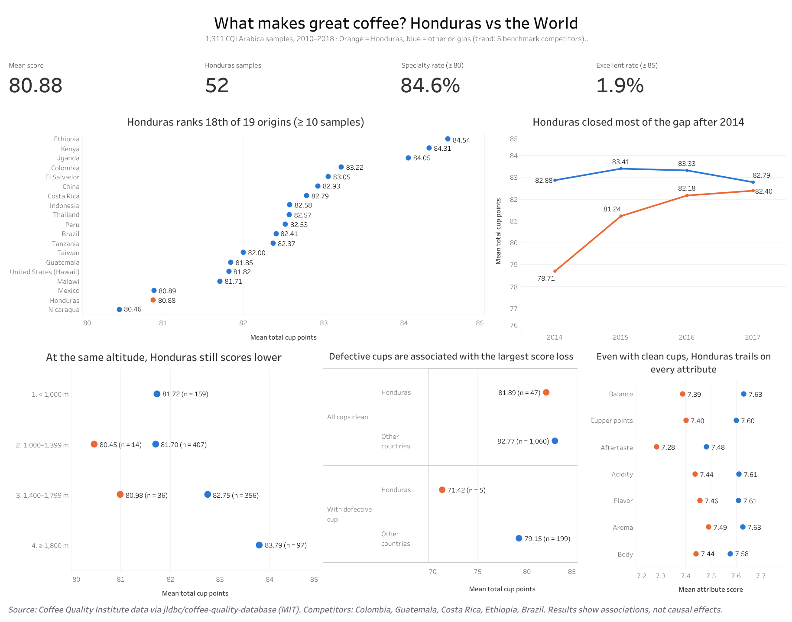
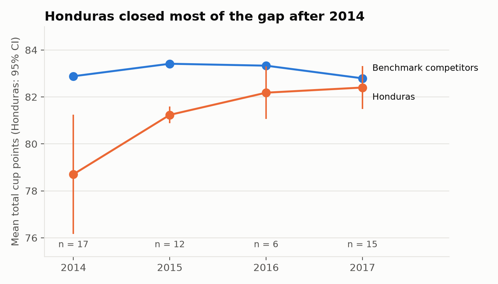
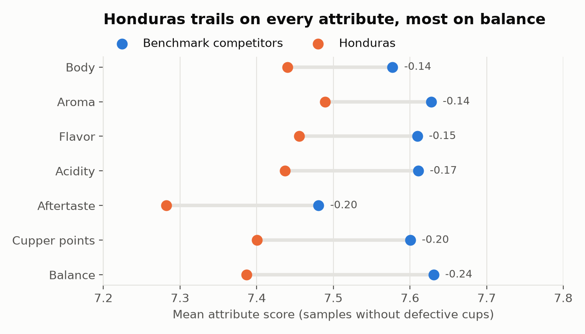

# What Makes Great Coffee? Quality Drivers for a Honduran Coffee Cooperative

> Google Data Analytics Capstone · *The client (Cooperativa Cafetalera Hondureña) is fictional; the data is real and public.*

**[Interactive dashboard](https://public.tableau.com/views/Whatmakesgreatcoffee-Honduras/HondurasQualityDashboard)** · **[Board presentation (PDF)](presentation/What%20Makes%20Great%20Coffee%20Board%20Presentation.pdf)** · **[Analysis notebook](notebooks/coffee_quality_analysis.ipynb)** · **Kaggle notebook:** _TBD_

**Tools:** SQL (BigQuery) · Python (pandas, SciPy, matplotlib) · Tableau Public



## Why this project

I chose coffee because I drink it every day and because it is one of the products my country, Honduras, is known for. I wanted to use data to help Honduran coffee become even better, and to practice the full analysis process as a junior data analyst: from a business question to recommendations a decision-maker can act on.

## Executive Summary

A Honduran coffee cooperative wants more of its coffee to qualify as **specialty grade (80+ points)**. Using 1,311 expert-graded Arabica samples from 36 countries, I benchmarked Honduras against five competitors and tested which factors are associated with higher scores.

**Key findings**
- **Honduras ranks 18th of 19** producing countries (mean 80.88 vs. 82.15 overall).
- The gap is at the **top, not at the specialty line**: specialty rate 84.6% (vs. 86.2%), but only **1 of 52** samples reached 85+.
- **Defective cups** are associated with the largest score loss (−3.77 points). Without them, Honduras' specialty rate would be **93.6%**.
- Even with clean cups, Honduras **trails on all 7 sensory attributes**, most on balance and aftertaste.
- **Altitude and processing method are not the main levers**: the altitude effect nearly disappears within countries, and methods differ by less than one point.

**Recommendations**
1. **Protect consistency:** cup every lot before export and standardize fermentation, drying and storage.
2. **Raise the ceiling:** a cup-quality program on the best lots (above 1,400 m), focused on balance and aftertaste.
3. **Pilot, don't switch:** test new processing methods on a few lots before any large change.

*Foundation:* record quality data for every lot. All findings are associations, not causes ([limitations](docs/05_act_recommendations.md#limitations)).

## Approach

The project follows the six phases of the Google Data Analytics process:

| Phase | What I did | Deliverable |
|---|---|---|
| 1. Ask | Defined the business task, stakeholders and guiding questions | [Business task](docs/01_ask_business_task.md) |
| 2. Prepare | Loaded the raw data into BigQuery, checked credibility (ROCCC), logged 28 exploration findings | [Data sources](docs/02_prepare_data_sources.md) · [SQL](sql/01_exploration.sql) |
| 3. Process | Cleaned types, categories and missing values in SQL; parsed free-text altitude (123 formats) and harvest year in Python with unit tests | [Cleaning changelog](docs/03_process_changelog.md) · [SQL](sql/02_cleaning.sql) · [Notebook §2](notebooks/coffee_quality_analysis.ipynb) |
| 4. Analyze | Benchmarks with 95% confidence intervals; Spearman, Kruskal–Wallis and Mann–Whitney tests; within-country comparisons to separate country effects | [Analysis summary](docs/04_analysis_summary.md) · [SQL](sql/03_analysis.sql) · [Notebook §3](notebooks/coffee_quality_analysis.ipynb) |
| 5. Share | Tableau Public dashboard and a board presentation | [Dashboard](https://public.tableau.com/views/Whatmakesgreatcoffee-Honduras/HondurasQualityDashboard) · [Presentation](presentation/What%20Makes%20Great%20Coffee%20Board%20Presentation.pdf) |
| 6. Act | Three prioritized recommendations with metrics, roadmap and limitations | [Recommendations](docs/05_act_recommendations.md) |

## Highlights

| Defective cups explain Honduras' low tail… | …but it still trails on every attribute |
|---|---|
|  |  |

## Skills Demonstrated

| Area | Examples in this project |
|---|---|
| **SQL (BigQuery)** | CTEs, window functions, `UNPIVOT`, `APPROX_QUANTILES`, regex parsing, validation queries |
| **Data cleaning** | Documented changelog (31 steps), explicit missing-value rules, a regex altitude parser covered by 21 unit tests, evidence-based value recovery |
| **Statistics** | 95% confidence intervals, non-parametric tests, robustness checks, separating confounders (country vs. altitude/method) |
| **Visualization** | Consistent chart style in matplotlib; dot plots instead of truncated bars; interactive Tableau dashboard |
| **Communication** | Executive deck with conclusion-first headlines; recommendations linked to measurable targets; stated limitations |

## Repository Structure
```
├── docs/            Phase documents (Ask → Act)
├── data/raw/        Original CQI data (unmodified)
├── data/interim/    Output of the SQL cleaning (input to the notebook)
├── data/clean/      Analysis-ready datasets (also used by Tableau)
├── sql/             BigQuery scripts: exploration, cleaning, analysis
├── notebooks/       Python notebook: parsing, statistics, charts
├── visuals/         Exported charts and dashboard image
└── presentation/    Board deck (PDF)
```

## Reproduce

```bash
python -m venv .venv
.venv/Scripts/activate          # Windows; use `source .venv/bin/activate` on macOS/Linux
pip install -r requirements.txt
jupyter notebook notebooks/coffee_quality_analysis.ipynb
```

The SQL scripts run in BigQuery on the raw file in `data/raw/` (schema in `sql/schema/`). The notebook starts from `data/interim/arabica_stage.csv`, so it can run without BigQuery.

## Data Source and Credits

- **Data:** Coffee Quality Institute (CQI) reviews, scraped in 2018 by James LeDoux: [jldbc/coffee-quality-database](https://github.com/jldbc/coffee-quality-database) (MIT License).
- **Course:** [Google Data Analytics Professional Certificate](https://www.coursera.org/professional-certificates/google-data-analytics) capstone.
- Independent educational project, not affiliated with or endorsed by CQI.

## Author

**Marzell Cribas** · Junior Data Analyst · [LinkedIn](https://www.linkedin.com/in/marzell-paolo-cribas-ramos-b23889345)
