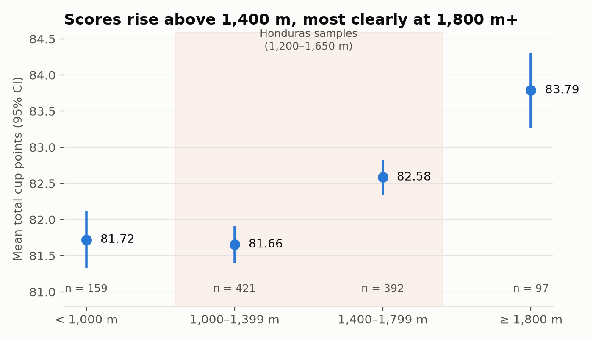
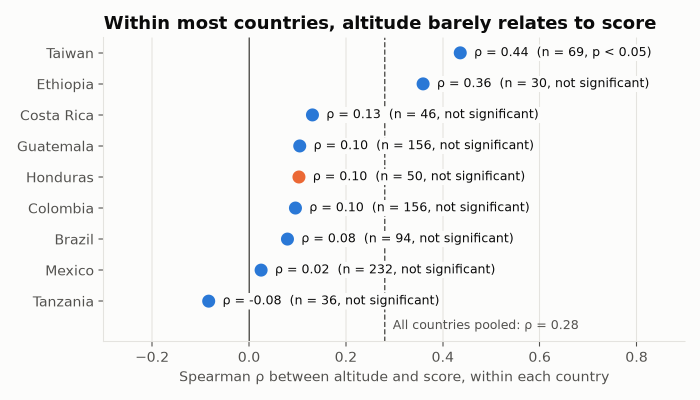
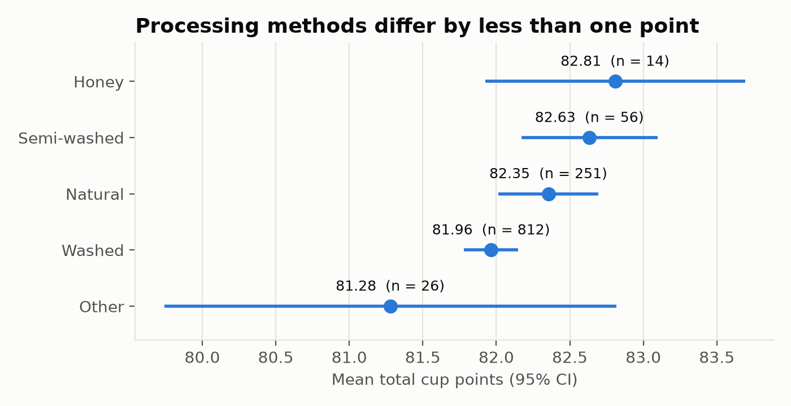
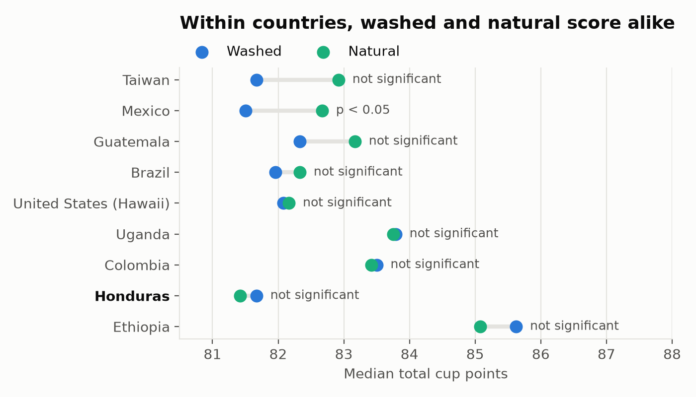
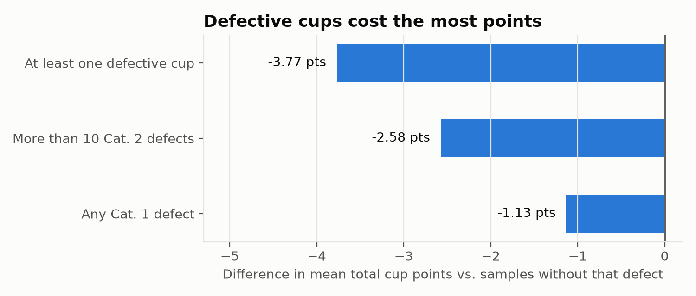
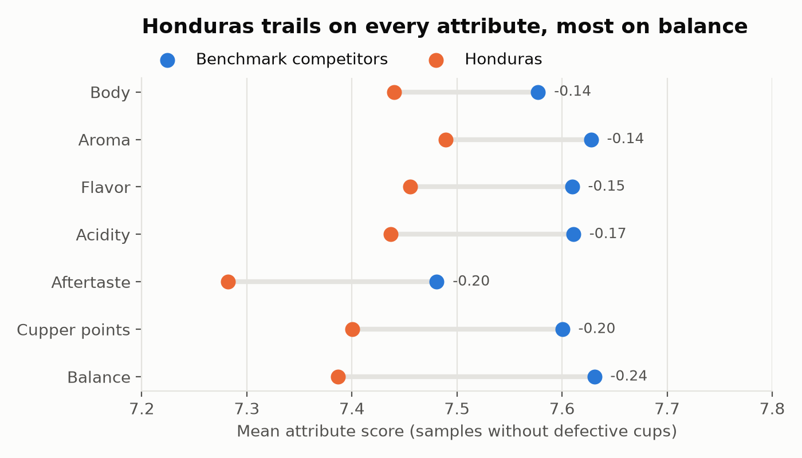
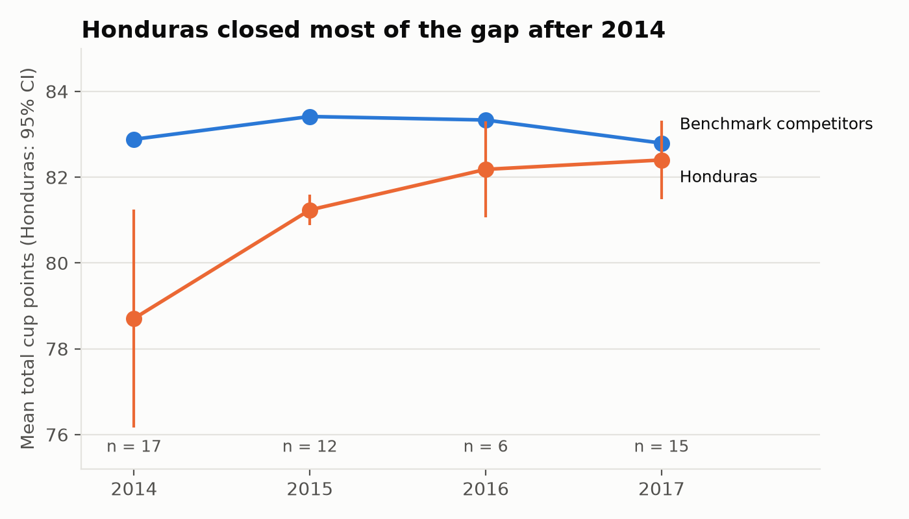

# Phase 4 — Analyze: Analysis Summary

**Data:** `coffee_quality.arabica_clean` (1,311 Arabica samples graded 2010–2018).
**Queries:** [`sql/03_analysis.sql`](../sql/03_analysis.sql) · **Notebook:** [`notebooks/coffee_quality_analysis.ipynb`](../notebooks/coffee_quality_analysis.ipynb)

**Method notes**
- Countries need **n ≥ 10** to be ranked (19 countries qualify).
- Uncertainty is shown with **95% confidence intervals** of the mean (mean ± 1.96 × std / √n). If two intervals overlap, the difference is not treated as conclusive.
- Because 86.2% of samples are already ≥ 80 (selection bias, F16), an **excellent rate (≥ 85)** is reported alongside the specialty rate.
- All results are **associations** among samples submitted to CQI.

## Q1 · Benchmark

**Honduras ranks 18th of 19 countries** by mean score (80.88; 95% CI 79.92–81.85).

| Country | n | Mean | Median | Gap vs. Honduras | Specialty % | Excellent (≥ 85) % |
|---|---|---|---|---|---|---|
| Ethiopia | 45 | 84.54 | 85.08 | +3.66 | 97.8 | 55.6 |
| Colombia | 190 | 83.22 | 83.33 | +2.33 | 96.3 | 6.8 |
| Costa Rica | 51 | 82.79 | 83.25 | +1.91 | 92.2 | 9.8 |
| Brazil | 132 | 82.41 | 82.42 | +1.52 | 95.5 | 6.1 |
| *All countries* | 1,311 | 82.15 | 82.58 | +1.27 | 86.2 | 8.1 |
| Guatemala | 181 | 81.85 | 82.42 | +0.96 | 81.2 | 5.0 |
| **Honduras** | **52** | **80.88** | **81.67** | — | **84.6** | **1.9** |

**Findings**
1. **East Africa leads** (Ethiopia, Kenya, Uganda are the top 3); Ethiopia's excellent rate (55.6%) is in a league of its own.
2. **Honduras is significantly below Colombia, Costa Rica and Brazil** (non-overlapping 95% CIs), but **not distinguishable from Guatemala, Mexico or Nicaragua** (overlapping CIs).
3. **The specialty rate is not Honduras' main gap** (84.6% vs. 86.2% overall). The gap is at the top: only **1 of 52** Honduran samples reaches 85+ (1.9% vs. 8.1% overall).
4. **A low-score tail pulls the mean down:** mean 80.88 vs. median 81.67. The 4 lowest Honduran samples (69.2–73.4, all graded in 2014) have `clean_cup` and `uniformity` of 8/10, meaning at least one cup out of five was defective. Without them the mean would be ~81.8, still in the bottom third of the ranking.

**Implication for the client:** Honduras has two distinct problems: (a) **consistency**, with occasional lots that have cup defects, and (b) **a ceiling**, rarely reaching excellent quality. They call for different investments.

## Q2 · Altitude

| Altitude band | n | Mean | 95% CI | Specialty % | Excellent % | Honduras n |
|---|---|---|---|---|---|---|
| < 1,000 m | 159 | 81.72 | 81.33–82.11 | 86.8 | 1.3 | 0 |
| 1,000–1,399 m | 421 | 81.66 | 81.40–81.91 | 79.6 | 5.0 | 14 |
| 1,400–1,799 m | 392 | 82.58 | 82.34–82.83 | 92.6 | 7.7 | 36 |
| ≥ 1,800 m | 97 | 83.79 | 83.27–84.31 | 95.9 | 26.8 | 0 |

**Findings**
1. **Not a straight line:** scores are flat below 1,400 m (~81.7) and rise above it (+0.9 at 1,400–1,799 m, +2.1 at ≥ 1,800 m). The excellent rate jumps from 7.7% to **26.8%** at 1,800 m+.
2. **Robust to cleaning assumptions:** excluding the 74 assumed-feet and recovered altitudes gives the same pattern (Spearman ρ = 0.289 vs. 0.280, both p < 0.001).
3. **But altitude is largely a country effect.** The pooled correlation is moderate (ρ = 0.28), yet **within** each major producer it is weak and not significant (ρ ≈ 0.0–0.13 for Mexico, Brazil, Colombia, Guatemala, Costa Rica and Honduras). The 1,800 m+ band is dominated by Colombia, Ethiopia, Costa Rica and Kenya, countries that also differ in varieties, processing and expertise. Altitude is a **marker** of high-quality origins more than a lever on its own.

**Implication for the client:** Honduran samples sit at 1,200–1,650 m (none above 1,800 m). Lots from **above 1,400 m** belong to the band associated with higher scores and are the natural candidates for a specialty program, but altitude alone should not be expected to close the gap: within-country evidence points to **what is done with the coffee** (processing, defect control) as the more actionable lever, which Q3 and Q4 test.

## Q3 · Processing Method

| Method | n | Mean | 95% CI | Excellent % | % with Cat. 1 defect | Mean Cat. 2 defects |
|---|---|---|---|---|---|---|
| Honey | 14 | 82.81 | 81.92–83.69 | 7.1 | 7.1 | 2.50 |
| Semi-washed | 56 | 82.63 | 82.17–83.10 | 10.7 | 7.1 | 3.50 |
| Natural | 251 | 82.35 | 82.01–82.69 | 11.2 | 19.1 | 4.21 |
| Washed | 812 | 81.96 | 81.78–82.15 | 5.5 | 14.4 | 3.77 |
| Other | 26 | 81.28 | 79.74–82.82 | 0.0 | 15.4 | 2.50 |
| *Unknown* | 152 | 82.70 | 82.06–83.35 | 17.1 | 17.1 | 1.91 |

**Findings**
1. **Methods differ by less than one point** (81.3–82.8). The difference in scores is borderline significant (Kruskal–Wallis p = 0.03); differences in defects are not (Cat. 1 p = 0.09, Cat. 2 p = 0.45).
2. **Semi-washed beats washed** with non-overlapping CIs and has few severe defects, **but** 43% of semi-washed samples are Brazilian and 25% Mexican: the comparison is partly a country effect.
3. **Natural has the highest share of samples with a severe defect** (19.1% vs. 14.4% washed), consistent with drying the bean inside the fruit (more risk of mold and over-fermentation), though not statistically significant.
4. **Honey looks best but n = 14** (its 7.1% excellent rate is a single sample); no conclusion can be drawn.
5. **Within the same country, washed and natural score alike** (Mann–Whitney not significant in 8 of 9 countries, including Honduras: washed 81.67 vs. natural 81.42 median, p = 0.82).
6. `Unknown` has the highest excellent rate because it contains many Ethiopian and Colombian samples, another country effect.

**Implication for the client:** the evidence does **not** support a large investment in *switching* processing methods. The method matters less than **how well it is executed**: Honduras' four lowest samples were washed lots with defective cups (Q1). A small, measured **pilot** (e.g., honey or semi-washed on a few lots, cupped before and after) is the evidence-based way to test a new method.

## Q4 · Defects

**Green-coffee defects**

| Category 2 defects | n | Mean | Median | Specialty % |
|---|---|---|---|---|
| 0 | 363 | 82.47 | 82.67 | 91.2 |
| 1–2 | 377 | 82.72 | 82.75 | 92.8 |
| 3–5 | 324 | 82.08 | 82.58 | 86.1 |
| 6–10 | 153 | 81.52 | 82.17 | 75.2 |
| > 10 | 94 | 79.89 | 80.42 | **58.5** |

| Category 1 defect | n | Mean | Median | Specialty % |
|---|---|---|---|---|
| None | 1,111 | 82.32 | 82.67 | 88.7 |
| At least one | 200 | 81.19 | 81.92 | **72.0** |

**Cup defects** (at least one of five cups failed: `clean_cup` or `uniformity` < 10)

| Defective cup | n | Mean | Specialty % | Honduras n |
|---|---|---|---|---|
| No | 1,107 | 82.74 | 93.7 | 47 |
| Yes | 204 | 78.97 | **45.6** | 5 |

**Defect profile vs. competitors**

| Country | n | % with Cat. 1 defect | Mean Cat. 2 defects | % with defective cup |
|---|---|---|---|---|
| Colombia | 190 | 20.0 | 1.88 | 4.7 |
| **Honduras** | **52** | **3.8** | **3.60** | **9.6** |
| Costa Rica | 51 | 15.7 | 2.82 | 9.8 |
| Brazil | 132 | 6.1 | 3.60 | 10.6 |
| Guatemala | 181 | 13.3 | 3.42 | 14.4 |
| Ethiopia | 45 | 11.1 | 5.04 | 17.8 |

**Findings**
1. **Green-coffee defects have a threshold effect.** A few Category 2 defects barely matter (0–5 defects: ~82–83 points); above 10 the specialty rate falls to **58.5%**. Any Category 1 defect is associated with −1.13 points and a specialty rate of 72.0% instead of 88.7%. Rank correlations are negative but weak (ρ = −0.12 for Cat. 1, −0.17 for Cat. 2; both p < 0.001).
2. **Cup defects are associated with the largest loss: −3.77 points**, and fewer than half of those samples reach specialty grade (45.6% vs. 93.7%). Part of this gap is mechanical, because `clean_cup`, `uniformity` and `sweetness` are components of the total (−2.61 points), but samples with a defective cup **also score 1.16 points lower on the 7 quality attributes**: the defect affects the whole cup, not just the per-cup deductions.
3. **Honduras is not a high-defect origin.** It has the **lowest share of severe green defects** among the benchmark (3.8%) and an average rate of defective cups (9.6%). Colombia has the most severe defects (20%) and still leads the region.
4. **Honduras' 5 defective-cup samples explain its low tail:** all were graded in 2014 and include its four lowest scores (69–73). Without them, Honduras' mean is **81.89**: still below Colombia, Costa Rica and Brazil.

**Implication for the client:** defects explain Honduras' **consistency problem** (the low tail), not its **ceiling problem**. Preventing defective cups (fermentation, drying and storage control, plus cupping lots before export) protects the specialty rate. Raising the ceiling requires understanding Honduras' **sensory profile** (Q5).

## Q5 · Sensory Profile

| Country | n | Aroma | Flavor | Aftertaste | Acidity | Body | Balance | Cupper pts |
|---|---|---|---|---|---|---|---|---|
| Ethiopia | 45 | 7.85 | 7.96 | 7.86 | 8.02 | 7.88 | 7.93 | 8.00 |
| Colombia | 190 | 7.66 | 7.62 | 7.54 | 7.58 | 7.62 | 7.72 | 7.64 |
| Costa Rica | 51 | 7.67 | 7.54 | 7.53 | 7.57 | 7.54 | 7.64 | 7.66 |
| Brazil | 132 | 7.55 | 7.57 | 7.44 | 7.51 | 7.54 | 7.53 | 7.56 |
| Guatemala | 181 | 7.54 | 7.49 | 7.27 | 7.60 | 7.48 | 7.47 | 7.39 |
| **Honduras** | **52** | **7.43** | **7.37** | **7.20** | **7.37** | **7.38** | **7.30** | **7.33** |

**Findings**
1. **Honduras is last among the benchmark on all 7 attributes.** Its gap to the competitors' average ranges from −0.18 (aroma) to −0.31 (balance); every gap is statistically significant (Mann–Whitney p < 0.001).
2. **The gap is not just the low tail.** Excluding samples with a defective cup, Honduras still trails on every attribute (−0.14 to −0.24), with **balance (−0.24), aftertaste (−0.20) and overall impression (−0.20)** as the largest gaps.
3. **Aftertaste is Honduras' lowest absolute score (7.20)**, the lowest value of any attribute in any benchmark country.
4. **The attributes move together** (Spearman ρ = 0.56–0.81 between attributes). A uniform gap points to **lower overall cup quality** rather than one isolated flaw; balance and aftertaste, which summarize how the whole cup holds together and finishes, are where it shows most.

**Implication for the client:** the ceiling problem is a **cup-quality problem across the board**, most visible in balance and aftertaste. Attributes like these are typically linked to cherry ripeness at harvest and to careful fermentation and drying (agronomic knowledge, not tested in this data). The cooperative needs **its own cupping data** to identify which practices move them, which makes systematic lot-level quality measurement a prerequisite for any investment.

## Extra · Honduras over time (2014–2017)

| Year | Honduras n | Honduras mean | Without defective cups | Competitors (mean of country means) | Gap |
|---|---|---|---|---|---|
| 2014 | 17 | 78.71 | 81.74 | 82.88 | −4.17 |
| 2015 | 12 | 81.24 | 81.24 | 83.41 | −2.17 |
| 2016 | 6 | 82.18 | 82.18 | 83.33 | −1.15 |
| 2017 | 15 | 82.40 | 82.40 | 82.79 | −0.39 |

**Findings**
1. **Honduras improved by 3.7 points between 2014 and 2017** and narrowed its gap to the competitors from −4.2 to −0.4 (trend ρ = 0.35, p = 0.01).
2. **Most of the improvement is the disappearance of defective cups:** all of them occurred in 2014. Without those samples the upward trend is not statistically significant (ρ = 0.20, p = 0.19).
3. **The ceiling has not moved:** Honduras' only excellent (≥ 85) sample appears in 2017; small yearly samples (6–17) keep the confidence intervals wide.

**Implication for the client:** the consistency problem appears **solvable**, since it did not recur in 2015–2017. The remaining task is raising the ceiling.

---

## Key Findings

| # | Finding | Evidence |
|---|---|---|
| 1 | **Honduras ranks 18th of 19** producing countries (mean 80.88), significantly below Colombia, Costa Rica and Brazil. | Q1 |
| 2 | Honduras' gap is at the **top**, not at the specialty line: specialty rate 84.6% (vs. 86.2% overall) but only **1 of 52** samples reaches 85+. | Q1 |
| 3 | **Defective cups** are associated with the largest score loss (−3.77 points; specialty rate 45.6% vs. 93.7%) and explain Honduras' low tail (all in 2014). | Q1, Q4, Extra |
| 4 | Honduras is **not a high-defect origin**: it has the lowest share of severe green defects in the benchmark (3.8%). | Q4 |
| 5 | Honduras trails competitors on **every sensory attribute**, even without defective cups, most on **balance and aftertaste**: an overall cup-quality gap. | Q5 |
| 6 | **Altitude** above 1,400 m is associated with higher scores, but mostly as a **country marker**: within countries the association is weak. | Q2 |
| 7 | **Processing method** matters little: < 1 point between methods and no consistent difference within countries. | Q3 |
| 8 | Honduras **improved after 2014** (gap −4.2 → −0.4), mainly by eliminating defective cups. | Extra |

**Bottom line:** Honduras' path to more specialty and excellent coffee is **quality control and cup quality**, not changing altitude or processing method. All findings are associations among samples submitted to CQI (2010–2018); see the limitations in Phase 2.
